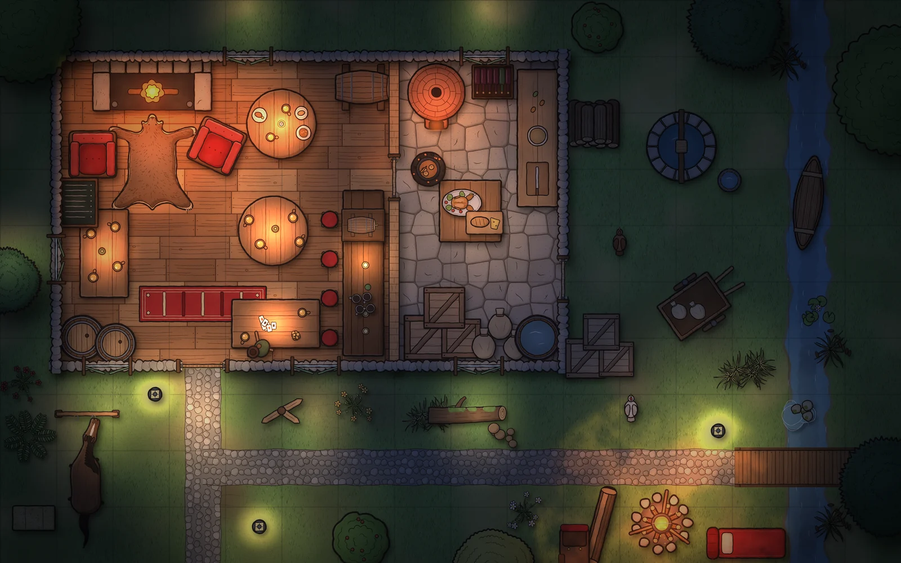
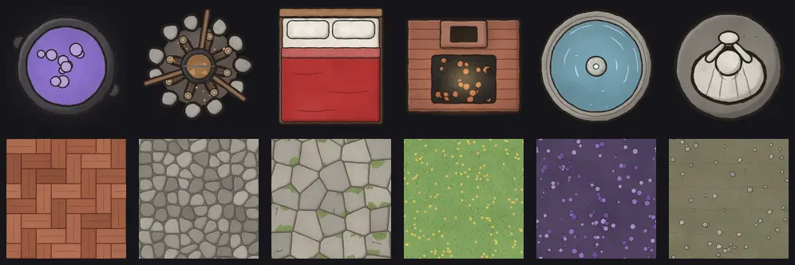

# Open20 Essentials

**Más de 2.000 assets para tus mapas de rol**, todos en el mismo estilo. 
Gratis, para Dungeondraft y para Open20 Battle Maps.

[**Descargar**](https://github.com/open20-rpg/open20-essentials/releases/latest/download/Open20-Essentials.dungeondraft_pack) · [open20.app](https://open20.app/essentials) · [Discord](https://discord.gg/KRHJm8x6rp)

 

## Qué trae

- **Objetos**: más de 1.300, en 26 grupos (taberna, magia, templo, mazmorra, campamento, pueblo, granja, puerto y más).
- **Suelos, terrenos, techos, paredes y caminos**: madera, piedra, baldosas, hierba, arena, nieve, tejas, pizarra…
- **Puertas, ventanas, cuevas y luces**: antorchas, ventanas, luz de luna, niebla…
- **Equipo del SRD 5.2.1**: armas, armaduras, objetos mágicos, herramientas y monturas.

## Cómo instalarlo

**En Dungeondraft**

1. Descarga [`Open20-Essentials.dungeondraft_pack`](https://github.com/open20-rpg/open20-essentials/releases/latest/download/Open20-Essentials.dungeondraft_pack).
2. Cópialo a la carpeta de assets que configuraste en Dungeondraft.
3. Abre Dungeondraft, activa **Open20 Essentials** en la lista de packs y empieza un mapa.

**En Open20 Battle Maps** ya viene incluido: no tienes que instalar nada.
[Descarga Battle Maps](https://open20.app/battle-maps).

Todas las versiones y sus novedades están en [Releases](https://github.com/open20-rpg/open20-essentials/releases).

## Comunidad

Novedades, ideas y pedidos de assets en [Discord](https://discord.gg/KRHJm8x6rp).
Si el pack te sirve, puedes apoyar el proyecto en [Patreon](https://www.patreon.com/open20rpg).

Open20 Essentials es parte de [Open20](https://open20.app), una suite de
herramientas para juegos de rol.

## Licencia

Los assets están bajo [CC BY 4.0](LICENSE-ASSETS.md): puedes usarlos en tus
mapas, también comerciales, dando crédito a Open20 Essentials. El código del
generador tiene licencia [MIT](LICENSE).

---

Open20 Essentials es un proyecto independiente, sin afiliación con Dungeondraft
ni Megasploot. Incluye material del System Reference Document 5.2.1
("SRD 5.2.1") de Wizards of the Coast LLC, disponible en
https://www.dndbeyond.com/srd, bajo licencia
[Creative Commons Attribution 4.0](https://creativecommons.org/licenses/by/4.0/legalcode).

Cada asset está dibujado por código: el generador está en [`scripts/`](scripts)
y la guía para colaborar en [`AGENTS.md`](AGENTS.md).
